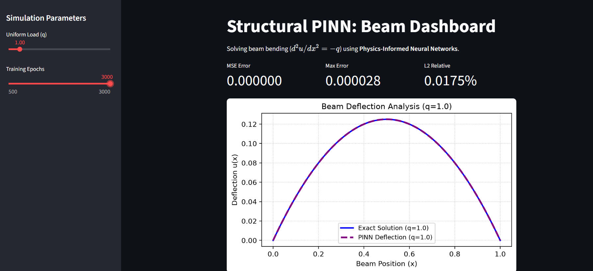
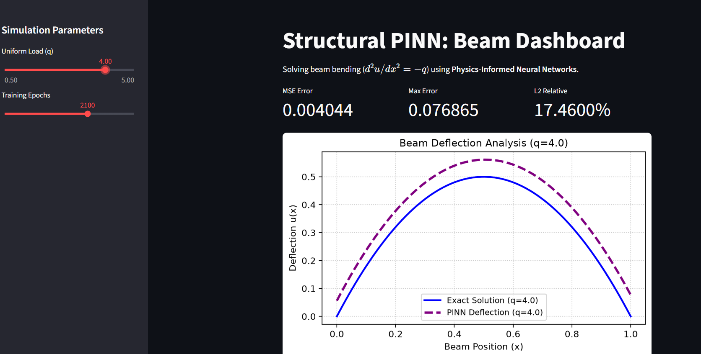

# 🏗️ Structural Integrity Analysis using Physics-Informed Neural Networks (PINNs)

An elite-level Scientific Machine Learning (SciML) web application that solves structural beam bending differential equations using **Physics-Informed Neural Networks (PINNs)** built with PyTorch and deployed via Streamlit.

---

## 🔬 Mathematical Formulation & Physics

Traditional Finite Element Analysis (FEA) relies on heavy mesh generation. This project uses deep learning constrained by governing differential equations (Scientific Machine Learning).

### 1. Governing Differential Equation
For a uniform beam under distributed load $q$, the Euler-Bernoulli beam deflection equation (2nd-order reduction) is:

$$\frac{d^2u}{dx^2} = -q$$

Where:
* $x \in [0, 1]$ is the normalized spatial position along the beam.
* $u(x)$ is the transverse deflection.
* $q$ is the uniform transverse load.

### 2. Boundary Conditions (BCs)
Pinned-pinned boundary conditions at both ends of the beam:
* $u(0) = 0$
* $u(1) = 0$

---

## 📊 Model Training & Convergence Analysis

Depending on training iterations (**Epochs**), the neural network learns the physical laws progressively:

| Fully Converged / Accurate (Epochs = 3000, q = 1.0) | Under-Trained / Initial Split (Epochs = 500, q = 5.0) |
| :---: | :---: |
|  |  |
| *PINN prediction overlaps perfectly with the exact analytical solution.* | *Visible divergence/gap showing the model learning physics mid-training.* |

---

## 🚀 Key Features
- **Physics-Informed Loss Function:** Combines physics residual loss ($d^2u/dx^2 = -q$) with boundary condition loss using PyTorch automatic differentiation (`autograd`).
- **Interactive Streamlit Dashboard:** Real-time parameter tuning for loads ($q$) and training epochs.
- **Quantitative Performance Metrics:** Live computation of **MSE Error**, **Max Absolute Error**, and **L2 Relative Error percentage**.

---

## 🛠️ Installation & Local Setup

1. **Clone the repository:**
   ```bash
   git clone [https://github.com/APKA_USERNAME/pinn-structural-integrity.git](https://github.com/APKA_USERNAME/pinn-structural-integrity.git)
   cd PINN_Structural_Integrity